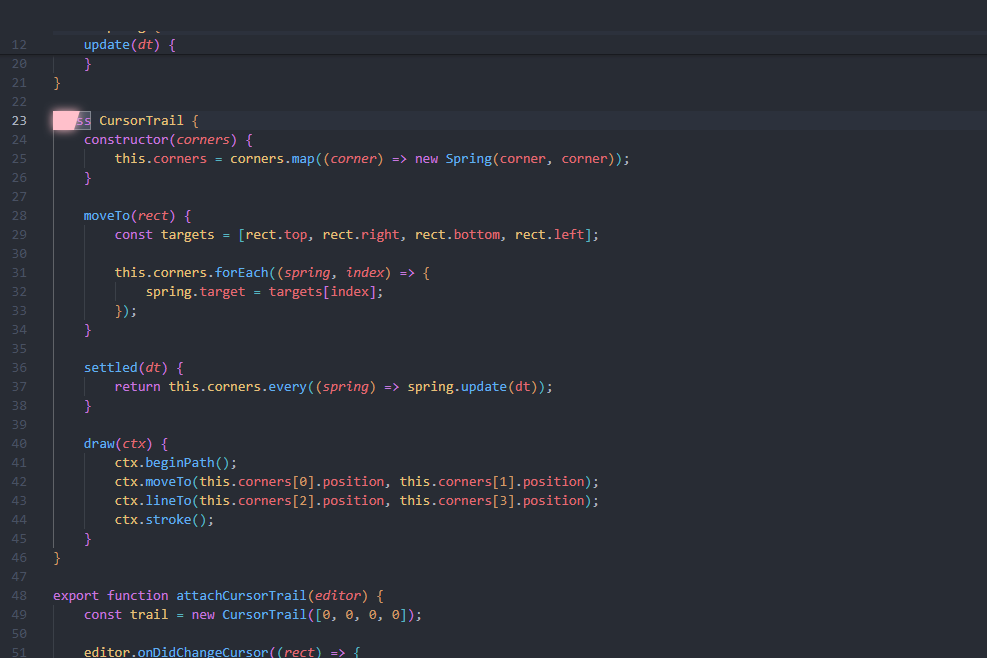

# Springy Cursor

Neovide / Zed style animated cursor trail for VS Code.

Based on [Neovide-Cursor](https://github.com/30d98f9b2/Neovide-Cursor) by LengineerC (MIT), with the runtime
rewritten: idle CPU is zero, the trail follows `devicePixelRatio`, it never paints outside the editor, and the
settings live in VS Code instead of a JS file inside the extension folder.

## Features

- **Four-corner damped springs.** Each corner of the cursor block is driven by a critically damped spring, so the
  block stretches and compresses depending on the direction of travel.
- **Zero idle cost.** A `MutationObserver` wakes `requestAnimationFrame` only when something moves; once every
  spring settles the loop stops completely.
- **HiDPI crisp.** The canvas follows `devicePixelRatio` and reacts to monitor changes.
- **Clipped to the editor.** Drawing is clipped to the owning editor's `.overflow-guard`, so the trail never bleeds
  into the sidebar, tab bar or split borders.
- **Scroll aware.** Virtual scrolling is measured against `.lines-content` and matched instead of animated.
- **Multi-cursor and split views** are picked up immediately.
- **Presets:** `neovide` (classic elastic), `subtle` (short and restrained), `zed` (smooth, no hard leading snap) and
  `custom`.

## Install

1. Install from the Marketplace — **no companion extension required**.
2. On the first start it patches `workbench.html` itself and asks for **one** `Reload Window`.

> Prefer to drive it manually? Set `springyCursor.autoEnable` to `false` and use the
> `Springy Cursor: Enable / Update Cursor Trail` and `Disable Cursor Trail` commands.

## How it works, and what it touches

VS Code gives extensions no access to the workbench DOM, so the runtime has to be injected into
`workbench.html` in the installation directory. This extension does that itself:

- The injected code sits in a marked block (`SPRINGY-CURSOR-START` / `END`) with the script inlined, and the
  original file is kept as `workbench.html.springy-pristine`.
- After every patch the matching `sha256` entry for `workbench.html` is rewritten in `product.json`, so VS Code
  does **not** complain that "your Code installation appears to be corrupt".
- A VS Code update replaces the install directory and resets `workbench.html`; the extension notices on startup and
  re-applies the patch, so you only reload the window once.
- It works in Restricted Mode (untrusted windows) — it only touches the local editor UI, never workspace contents.
- `Disable Cursor Trail` restores the original file byte for byte (CSP included); uninstalling the extension does the
  same cleanup automatically.

## Settings

Search for `springyCursor` in Settings, then reload the window when prompted.

| Setting | Type | Default | Description |
| --- | --- | --- | --- |
| `springyCursor.autoEnable` | boolean | `true` | Patch automatically on first start and after a VS Code update |
| `springyCursor.color` | string | `"#FFC0CB"` | Trail color. Leave empty to use the theme's `--vscode-editorCursor-foreground` |
| `springyCursor.opacity` | number | `1` | Trail opacity (0–1) |
| `springyCursor.glow` | boolean | `true` | Draw a glow around the trail |
| `springyCursor.glowBlur` | number | `0.5` | Glow blur radius as a multiple of the cursor size |
| `springyCursor.preset` | string | `"neovide"` | `neovide`, `subtle`, `zed` or `custom` |
| `springyCursor.animationLength` | number | `0.125` | Jump animation length in seconds (custom preset) |
| `springyCursor.shortAnimationLength` | number | `0.05` | Same-line moves such as typing (custom preset) |
| `springyCursor.animateOnTyping` | boolean | `true` | Animate short single-line moves |
| `springyCursor.animateOnSelection` | boolean | `true` | Animate while selecting text |
| `springyCursor.rankTrailFactors` | number[] | `[1, 0.9, 0.5, 0.3]` | Per-corner duration multipliers, most trailing first |
| `springyCursor.hardSnap` | boolean | `true` | Snap leading corners quickly for the elastic stretch |
| `springyCursor.leadingSnapFactor` | number | `0.1` | Animation-length multiplier for leading corners |
| `springyCursor.leadingSnapThreshold` | number | `0.5` | Direction alignment above which a corner counts as leading |

## Limitations

- Changing a setting needs one window reload, because the script is inlined into `workbench.html`.
- The VS Code installation directory has to be writable. Installs under `C:\Program Files` need elevation; if the
  checksum cannot be rewritten the "installation appears to be corrupt" notice stays and can be silenced with
  *Don't Show Again*.

## 中文说明

Neovide / Zed 风格的光标拖尾扩展，用四角阻尼弹簧驱动光标块，附带拖尾与发光。空闲时完全停止 `requestAnimationFrame`，跟随 HiDPI，绘制裁剪在编辑器内，支持多光标与分屏。

**安装**：从 Marketplace 安装（不需要额外插件）→ 首次启动自动完成注入 → 按提示点一次 `Reload Window`。

**注意**：改设置需要重载一次窗口；VS Code 升级后扩展会自动补回注入，无需手动操作；`Disable Cursor Trail` 会把 `workbench.html` 按原始字节还原，卸载扩展时也会自动清理。

## License

MIT. Original work by [LengineerC](https://github.com/LengineerC/vscode-neovide-cursor), fork maintained at
[30d98f9b2/Neovide-Cursor](https://github.com/30d98f9b2/Neovide-Cursor).
